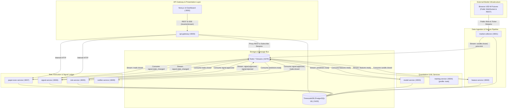
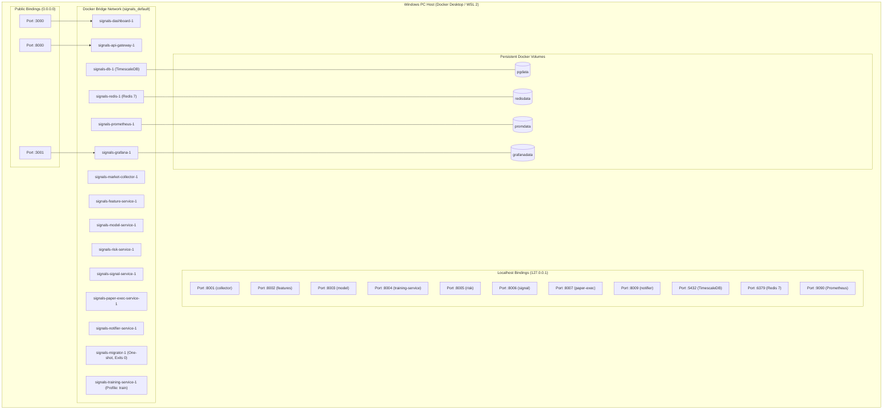

# System Architecture & Technical Specification

> **Scope**: Crypto futures paper trading & research only. Strictly zero real order execution and zero exchange private keys.
> **Project Name**: `signals` (Docker Compose project)

---

## 1. System Context & Overview

The **Trade AI Dashboard** is an institutional-grade, event-driven cryptocurrency algorithmic research platform and paper trading system. The runtime environment is composed of **9 Python 3.11 FastAPI microservices**, **1 Next.js 14 Web Dashboard**, and an infrastructure layer consisting of **TimescaleDB (PostgreSQL 16)**, **Redis 7 Streams**, **Prometheus**, and **Grafana** (totaling 13 active containers in standard runtime, plus a one-shot database migrator and an on-demand training service).

### High-Level Architectural Principles:
1. **Strict Microservice Boundaries**: Each microservice owns an isolated domain schema in PostgreSQL and communicates with other services asynchronously via versioned Redis Streams or synchronously via internal HTTP.
2. **Server-Authoritative Lifecycle**: The Next.js dashboard is strictly a **read-only client**. It connects exclusively to the `api-gateway` via REST queries and multiplexed Server-Sent Events (SSE). Client browsers never communicate with external exchanges and cannot mutate trade or signal state.
3. **Idempotence & Concurrency Control**: Every event contains an `idempotency_key` and is tracked in a database outbox. Signal state transitions are guarded by database-level **optimistic concurrency control** (`version` column increment). Portfolio exposure calculations and signal approvals are strictly serialized through a PostgreSQL transaction-level advisory lock (`RISK_ADVISORY_LOCK_ID = 888888`).
4. **Single-Owner Position Exits**: `paper-exec-service` is the sole owner of live position lifecycle and TP/SL barrier exits on price ticks (conservative **SL-first rule**). `signal-service` listens to `trade.closed` events to synchronize the signal ledger, eliminating duplicate tick evaluation across microservices.

---

## 2. System Context Diagram (Mermaid)



---

## 3. Microservice Inventory & Specifications

| Service | Port | Host Bind | Owned Schema | Database Tables Owned | Produced Events | Consumed Events / Dependencies | Compose Profile |
| :--- | :---: | :---: | :--- | :--- | :--- | :--- | :---: |
| **`market-collector`** | `8001` | `127.0.0.1:8001` | `market_data` | `candles`, `funding_rates`, `open_interest`, `taker_volume`, `symbols` | `candle.closed`, `price.tick` | Binance USD-M Public WS & REST | Default |
| **`feature-service`** | `8002` | `127.0.0.1:8002` | `feature_store` | `features` | `features.ready` | `candle.closed` (Group: `feature-service-group`) | Default |
| **`model-service`** | `8003` | `127.0.0.1:8003` | `model_registry` | `shadow_predictions`, `drift_reports` | `prediction.ready` | `features.ready` (Group: `model-service-group`) | Default |
| **`training-service`** | `8004` | `127.0.0.1:8004` | `model_registry` | `models`, `experiments` | None (Offline Model Registry) | DB Historical Hypertables | `train` |
| **`risk-service`** | `8005` | `127.0.0.1:8005` | Shared / Advisory | Postgres advisory lock `888888` | `signal.approved`, `signal.rejected` | `prediction.ready` (Group: `risk-service-group`) | Default |
| **`signal-service`** | `8006` | `127.0.0.1:8006` | `signals_ledger` | `signals` | `signal.state_changed` | `signal.approved`, `trade.closed` (Group: `signal-service-group`) | Default |
| **`paper-exec-service`** | `8007` | `127.0.0.1:8007` | `paper_execution` | `paper_trades` | `trade.closed` | `signal.state_changed`, `price.tick` (Group: `paper-exec-group`) | Default |
| **`api-gateway`** | `8000` | `0.0.0.0:8000` | `outbox` | `events` (read-only outbox monitor) | None (SSE Multiplexer) | REST to internal services; Redis Streams | Default |
| **`notifier-service`** | `8009` | `127.0.0.1:8009` | None | Stateless | External Webhooks (Discord/Telegram) | `signal.approved`, `trade.closed` (Group: `notifier-service-group`) | Default |
| **`dashboard`** | `3000` | `0.0.0.0:3000` | None | Read-only UI Client | None | HTTP / SSE to `api-gateway:8000` | Default |
| **`migrator`** | — | None | All | All schemas & Alembic metadata | None (Exits `0`) | PostgreSQL `db:5432` | Default |

---

## 4. Database Architecture & Schema Isolation

TimescaleDB runs as PostgreSQL 16 with the TimescaleDB extension enabled. Domain boundaries are enforced at the PostgreSQL schema level:

```
trade_ai (PostgreSQL 16 + TimescaleDB)
├── market_data        # Owned by market-collector
│   ├── symbols
│   ├── candles (Hypertable: 30-day chunks, compressed)
│   ├── funding_rates (Hypertable: 90-day chunks)
│   ├── open_interest (Hypertable: 30-day chunks)
│   └── taker_volume (Hypertable: 30-day chunks)
├── feature_store      # Owned by feature-service
│   └── features (Hypertable: 30-day chunks)
├── model_registry     # Owned by training-service & model-service
│   ├── models (Champion / Challenger / Retired metadata & metrics)
│   ├── experiments (Complete trial count registry for dynamic DSR)
│   ├── shadow_predictions (Shadow model out-of-sample audit log)
│   └── drift_reports (PSI / Wasserstein distribution drift logs)
├── signals_ledger     # Owned by signal-service
│   └── signals (Server-authoritative state machine with optimistic locking)
├── paper_execution    # Owned by paper-exec-service
│   └── paper_trades (Simulated fills, fees, funding accruals, PnL)
└── outbox             # Transactional Outbox pattern
    └── events (Deduplication keys, publishing status)
```

### Roles and Database Credentials
- Default user: `postgres` / `postgres` (configurable via `POSTGRES_USER` and `POSTGRES_PASSWORD`).
- Host port binding: `127.0.0.1:5432` (restricted to localhost; external network access is blocked).
- Migrations: Single, unified Alembic runner (`libs/database/migrations/env.py`) invoked via the `migrator` container before application services start up.

---

## 5. Messaging & Event Bus (Redis 7 Streams)

Inter-service communication utilizes **Redis 7 Streams** with persistent consumer groups. Unlike raw Redis Pub/Sub, Redis Streams provide guaranteed delivery, message persistence, explicit consumer group acknowledgements (`XACK`), and retry handling with Dead-Letter Queuing.

### Event Streaming Architecture:
1. **Envelope Contract**: Every event inherits from `BaseEvent` (`libs/contracts/events.py`):
   - `event_id`: Unique UUID4 identifier.
   - `event_type`: Dot-separated event classifier (e.g., `candle.closed`).
   - `event_version`: Semantic schema version (`"1.0"`).
   - `idempotency_key`: Deterministic unique deduplication key.
   - `timestamp`: ISO-8601 UTC timestamp.
   - `producer`: Service generating the event.
   - `payload`: Strongly typed Pydantic V2 model.
2. **Stream Trimming**: Streams are bounded using Redis approximate trimming (`maxlen=10000`) to prevent memory exhaustion.
3. **Consumer Groups**: Each downstream service registers its own named consumer group (`xgroup_create(stream, group_name, id="$", mkstream=True)`), ensuring that scaling instances share work without duplicate processing.
4. **Dead-Letter Queue (`system.dlq`)**: If a message fails processing after retry attempts, it is routed to the `system.dlq` stream with full error diagnostic metadata (`failed_service`, `original_stream`, `error_type`, `error_message`, `raw_payload`, `retry_count`).

---

## 6. Concurrency, Sizing & Locking Model

### Optimistic Concurrency Control (Signal Ledger)
Signal state updates are protected against race conditions using a strict `version` counter:
```sql
UPDATE signals_ledger.signals
SET status = :new_status,
    version = version + 1
WHERE id = :signal_id AND version = :current_version
RETURNING version;
```
If two processes attempt to mutate the same signal concurrently, only the process possessing the current version succeeds; the second receives zero rows affected and rejects the transition.

### Transactional Advisory Lock (Risk Service)
To prevent race conditions during portfolio margin allocation and concurrent signal approvals across multiple trading pairs, `risk-service` acquires a PostgreSQL transaction-level advisory lock (`RISK_ADVISORY_LOCK_ID = 888888`):
```sql
SELECT pg_advisory_xact_lock(:lock_id);
```
This guarantees that portfolio risk checks, cluster exposure limits, and capital reservations execute atomically across the cluster. The lock is automatically released upon transaction commit or rollback.

---

## 7. Presentation & API Gateway Architecture

The client dashboard is a **Next.js 14** application operating in server-side rendered (SSR) and client-hydrated modes.

### Strict Read-Only Policy:
- **No Exchange Access**: The browser does not connect to Binance or third-party crypto APIs (optional CoinGecko fallback for fiat currency display only).
- **No Direct Service Calls**: The dashboard connects solely to `api-gateway:8000`.
- **No State Mutations**: The dashboard does not compute or publish signal transitions. Earlier legacy proxy routes (`/api/signals/transition`) were completely excised.
- **Multiplexed SSE Stream**: The gateway provides an active Server-Sent Events endpoint (`GET /events/stream`) delivering real-time price updates (throttled to 1/s/symbol) and signal lifecycle events with `Last-Event-ID` reconnection replay and 15-second keep-alive heartbeats (`: heartbeat\n\n`).

---

## 8. Container Deployment Topology Diagram (Mermaid)


