# Trade AI Architecture Documentation: Event-Driven Microservices

## 1. System Overview

Trade AI Dashboard v0.1 has been refactored from a monolithic application into a production-grade, event-driven microservices architecture. The system is engineered strictly for **PAPER TRADING and quantitative research** with zero real order execution and zero exchange private keys.

---

## 2. Service Architecture & Boundary Diagram

All node labels below are explicitly quoted to guarantee Mermaid syntax validity across all renderers.

```mermaid
flowchart TD
    subgraph "External Ingestion"
        BINANCE["Binance USD-M Futures (REST & WS)"]
    end

    subgraph "Market & Feature Ingestion Tier"
        COLLECTOR["market-collector (:8001)"]
        FEATURE["feature-service (:8002)"]
    end

    subgraph "Machine Learning Tier"
        MODEL["model-service (:8003)"]
        TRAIN["training-service (:8004)"]
    end

    subgraph "Risk & Lifecycle Execution Tier"
        RISK["risk-service (:8005)"]
        SIGNAL["signal-service (:8006)"]
        EXEC["paper-exec-service (:8007)"]
    end

    subgraph "Presentation & Notification Tier"
        GATEWAY["api-gateway (:8000)"]
        NOTIFIER["notifier-service (:8009)"]
        DASHBOARD["Next.js 14 Dashboard (:3000)"]
    end

    subgraph "State & Event Infrastructure"
        REDIS[("Redis 7 Streams & Price Cache")]
        DB[("TimescaleDB Domain Hypertables")]
    end

    %% Ingestion flows
    BINANCE -->|"Multiplexed WS & REST"| COLLECTOR
    COLLECTOR -->|"price.tick & candle.closed"| REDIS
    COLLECTOR -->|"Insert OHLCV & Funding"| DB

    %% Feature & Inference flows
    REDIS -->|"candle.closed"| FEATURE
    FEATURE -->|"Load historical bars"| DB
    FEATURE -->|"features.ready"| REDIS
    FEATURE -->|"Save feature vectors"| DB

    REDIS -->|"features.ready"| MODEL
    MODEL -->|"Load Champion & Challenger"| DB
    MODEL -->|"prediction.ready (live & shadow)"| REDIS
    MODEL -->|"Save shadow predictions"| DB

    %% Training flows
    TRAIN -->|"Batch Purged CPCV Training"| DB
    TRAIN -->|"Enroll Challenger / Audit"| DB

    %% Risk & Execution flows
    REDIS -->|"prediction.ready"| RISK
    RISK -->|"Advisory Lock & MTM State"| DB
    RISK -->|"signal.approved / signal.rejected"| REDIS

    REDIS -->|"signal.approved & price.tick"| SIGNAL
    SIGNAL -->|"Optimistic Lock Transitions"| DB
    SIGNAL -->|"signal.state_changed"| REDIS

    REDIS -->|"signal.state_changed & price.tick"| EXEC
    EXEC -->|"Open / Close Paper Trades"| DB
    EXEC -->|"trade.closed"| REDIS
    EXEC -->|"Transactional Outbox"| DB

    %% Client & Alerting flows
    REDIS -->|"SSE stream & Redis ticks"| GATEWAY
    GATEWAY -->|"Query signals, history, status"| DB
    GATEWAY -->|"Multiplexed SSE (/events/stream)"| DASHBOARD
    REDIS -->|"signal.approved & trade.closed"| NOTIFIER
```

---

## 3. Microservice Catalog & Port Allocation

| Service | Port | Primary Responsibilities | Consumed Events | Produced Events |
| :--- | :---: | :--- | :--- | :--- |
| **`api-gateway`** | `8000` | Single public entrypoint, SSE multiplexer (`/events/stream`), status registry, REST endpoints | `signal.state_changed`, `price.tick` | Client SSE Dispatches |
| **`market-collector`** | `8001` | Ingests Binance USD-M 8 perpetuals (15m, 1h, 4h), funding rates, OI, gap backfill, 1200 weight budgeter | External Binance WS/REST | `candle.closed`, `price.tick` |
| **`feature-service`** | `8002` | Strict point-in-time causal indicators (TA-Lib, derivatives, BTC correlations, regime scores) | `candle.closed` | `features.ready` |
| **`model-service`** | `8003` | Calibrated LightGBM + RF meta-inference, hot-swap registry loader, shadow mode segregation | `features.ready` | `prediction.ready` (is_shadow flag) |
| **`training-service`** | `8004` | Batch training: $t+1$ limit fill, PurgedKFold, CPCV, DSR, PBO, leakage audit, promotion gatekeeper | REST `POST /train` | Model Artifacts & Drift Reports |
| **`risk-service`** | `8005` | 0.5% ATR sizing, 3x leverage cap, correlation clusters (max 2), circuit breaker halts, advisory locks | `prediction.ready` | `signal.approved`, `signal.rejected` |
| **`signal-service`** | `8006` | Server-authoritative lifecycle state machine with optimistic locking and in-memory tick index | `signal.approved`, `price.tick` | `signal.state_changed` |
| **`paper-exec-service`**| `8007` | Trade-through buffer (0.05%), conservative SL-first rule, funding fee accrual, equity curve | `signal.state_changed`, `price.tick` | `trade.closed` (Stream & Outbox) |
| **`notifier-service`** | `8009` | Telegram markdown trade alerts, collector stall heartbeat detector (> 60s) | `signal.approved`, `trade.closed`, `system.dlq` | Telegram Bot Notifications |
| **`dashboard`** | `3000` | Next.js 14 UI, model matrix status (champion/shadow/disabled), paper trading analytics | REST & SSE via Gateway | User Interface |

---

## 4. Price Usage Rules (Mark Price vs. Last Price)

To eliminate market manipulation vulnerabilities and ensure execution realism:
1. **Mark Price (Index / Fair Price)**:
   - Used for **account mark-to-market valuation**, **unrealized PnL**, **liquidation distance checks**, and **circuit breaker halts**.
   - Used for **Stop Loss execution**: Stop loss orders trigger against mark price to prevent synthetic stop-hunting spikes.
2. **Last Trade Price & Trade-Through Buffer**:
   - Used for **limit order queue penetration**: In simulated paper trading, limit orders and take-profit targets do not fill merely by touching the limit price. Price must penetrate the limit level by at least **0.05%** (`trade_through_buffer_pct = 0.0005`) to model realistic exchange queue priority.

---

## 5. Machine Learning Validation & Promotion Protocol (Phase 3.1)

No model is promoted to champion automatically. All models must satisfy:
1. **$t+1$ Limit-Entry Rule**: Entries are simulated strictly on the bar following signal generation with fill rate tracking.
2. **Causal Purging & Embargo**: Purged cross-validation with $\text{embargo} \ge \text{max\_holding\_bars}$ (24 bars).
3. **Strict Promotion Gates**:
   - Positive holdout Net EV after 14 bps friction and funding accrual.
   - $95\%$ bootstrap confidence interval lower bound $> 0$.
   - Minimum trade count $N \ge 20$ (holdout) and $\ge 100$ (full dataset).
   - Expected Calibration Error $\text{ECE} \le 0.12$.
   - Median CPCV path net Sharpe $> 0$.
4. **Mandatory Shadow Period**: Eligible models (e.g. BTC and ETH 1h/4h) are enrolled strictly as **Challengers (Shadow Mode)** for a mandatory **30–60 day forward paper-testing period** before any champion promotion.

---

## 6. Database Schemas (TimescaleDB)

- `market_data`: `candles` (hypertable), `funding_rates` (hypertable), `open_interest` (hypertable), `symbols`.
- `feature_store`: `features` (hypertable with JSONB feature vector).
- `model_registry`: `models`, `drift_reports`, `shadow_predictions`.
- `signals_ledger`: `signals` (with `version` column for optimistic concurrency control).
- `paper_execution`: `paper_trades` (with partial unique index `one_open_trade_per_signal WHERE closed_at IS NULL`), `equity_curve`.
- `outbox`: `events` (transactional outbox pattern).

