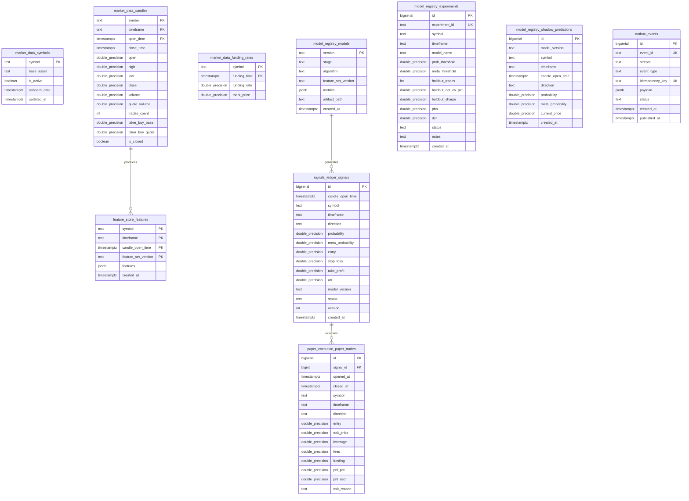

# Database Architecture & Domain Data Model

> **Database Engine**: PostgreSQL 16 with TimescaleDB extension enabled.
> **Database Name**: `trade_ai` (with scratch DB `trade_ai_scratch` for isolated restore testing).
> **Migration Engine**: Alembic single runner (`libs/database/migrations/`).

---

## 1. Domain Schema Architecture

The database enforces domain-driven service boundaries across six isolated PostgreSQL schemas:

```
trade_ai
├── market_data        # Raw market feeds, candles, funding rates, open interest
├── feature_store      # Point-in-time causal technical & derivatives indicator matrices
├── model_registry     # Model artifacts, experiment trials, shadow predictions, drift reports
├── signals_ledger     # Authoritative signal state machine with optimistic locking
├── paper_execution    # Paper trades, simulated fills, fees, funding accruals, PnL
└── outbox             # Transactional Outbox pattern for guaranteed event dispatch
```

---

## 2. Entity-Relationship Diagram (Mermaid)



---

## 3. Detailed Schema & Table Specifications

### 1. `market_data` Domain
Owned exclusively by `market-collector`.

#### `market_data.candles` (TimescaleDB Hypertable)
- **Primary Key**: `(symbol, timeframe, open_time)`
- **Chunk Interval**: `INTERVAL '30 days'`
- **Compression**: Enabled. Segmented by `symbol, timeframe`; ordered by `open_time DESC`. Compression policy triggers after 30 days.
- **Index**: `candles_open_time_idx` (`open_time DESC`).

#### `market_data.funding_rates` (TimescaleDB Hypertable)
- **Primary Key**: `(symbol, funding_time)`
- **Chunk Interval**: `INTERVAL '90 days'`
- **Columns**: `symbol` (text), `funding_time` (timestamptz), `funding_rate` (float8), `mark_price` (float8).

#### `market_data.open_interest` (TimescaleDB Hypertable)
- **Primary Key**: `(symbol, timeframe, timestamp)`
- **Chunk Interval**: `INTERVAL '30 days'`

#### `market_data.taker_volume` (TimescaleDB Hypertable)
- **Primary Key**: `(symbol, period, ts)`
- **Chunk Interval**: `INTERVAL '30 days'`

---

### 2. `feature_store` Domain
Owned exclusively by `feature-service`.

#### `feature_store.features` (TimescaleDB Hypertable)
- **Primary Key**: `(symbol, timeframe, candle_open_time, feature_set_version)`
- **Chunk Interval**: `INTERVAL '30 days'`
- **Payload**: `features` (`jsonb`) storing 48 causal point-in-time technical and derivatives indicators.

---

### 3. `model_registry` Domain
Owned jointly by `training-service` and `model-service`.

#### `model_registry.models`
Stores production model promotion status, checksums, and evaluation metrics.
- **Primary Key**: `version` (text) (e.g. `LGBM-V31-BTCUSDT-1h-20261111120000`).
- **Columns**:
  - `stage`: `"champion"` | `"challenger"` | `"retired"`.
  - `algorithm`: `"lightgbm_calibrated_platt"`.
  - `feature_set_version`: `"v1.0.0"`.
  - `metrics`: JSON payload containing holdout metrics, CPCV distributions, PBO, DSR, ECE, and gate decisions.
  - `artifact_path`: Relative filesystem path to serialized joblib bundles.

#### `model_registry.experiments`
Automated quantitative trial registry tracking every parameter grid and threshold search. Provides the ground truth trial count for Bailey & López de Prado's Deflated Sharpe Ratio.
- **Primary Key**: `id` (`bigserial`).
- **Unique Constraint**: `experiment_id` (`text UNIQUE`, e.g. `EXP-209`).
- **Columns**: `symbol`, `timeframe`, `model_name`, `prob_threshold`, `meta_threshold`, `holdout_trades`, `holdout_net_ev_pct`, `holdout_sharpe`, `pbo`, `dsr`, `status`, `notes`.

#### `model_registry.shadow_predictions`
Logs out-of-sample forward predictions for shadow models running in production without capital risk.
- **Primary Key**: `id` (`bigserial`).
- **Unique Constraint**: `uq_shadow_prediction (model_version, symbol, timeframe, candle_open_time)`.

#### `model_registry.drift_reports`
Tracks Population Stability Index (PSI) and Wasserstein distance distribution drift.
- **Primary Key**: `id` (`bigserial`).
- **Foreign Key**: `model_version REFERENCES model_registry.models(version)`.

---

### 4. `signals_ledger` Domain
Owned exclusively by `signal-service`.

#### `signals_ledger.signals`
Server-authoritative signal registry governed by optimistic concurrency control.
- **Primary Key**: `id` (`bigserial`).
- **Unique Constraint**: `uq_signal_instance UNIQUE (symbol, timeframe, candle_open_time, direction)`.
- **Concurrency Control**: `version` (`integer NOT NULL DEFAULT 1`). Every state transition executes an atomic version increment:
  ```sql
  UPDATE signals_ledger.signals
  SET status = :new_status, version = version + 1
  WHERE id = :id AND version = :current_version
  RETURNING version;
  ```
- **Indexes**:
  - `idx_signals_status` (`status, created_at DESC`).
  - `idx_signals_symbol` (`symbol, created_at DESC`).

---

### 5. `paper_execution` Domain
Owned exclusively by `paper-exec-service`.

#### `paper_execution.paper_trades`
Stores simulated order executions, leverage, fee deductions, and realized PnL.
- **Primary Key**: `id` (`bigserial`).
- **Foreign Key**: `signal_id REFERENCES signals_ledger.signals(id)`.
- **Integrity Rule**: Partial unique index guaranteeing that a signal can have at most one active open trade at any time:
  ```sql
  CREATE UNIQUE INDEX one_open_trade_per_signal
  ON paper_execution.paper_trades (signal_id)
  WHERE closed_at IS NULL;
  ```
- **Index**: `idx_trades_closed_at` (`closed_at DESC`).

---

### 6. `outbox` Domain
Provides the **Transactional Outbox Pattern** guaranteeing at-least-once event publication across the distributed system.

#### `outbox.events`
- **Primary Key**: `id` (`bigserial`).
- **Unique Constraints**: `event_id` (`text UNIQUE`), `idempotency_key` (`text UNIQUE`).
- **Index**: `idx_outbox_pending (status, id ASC) WHERE status = 'pending'`.
- **Lifecycle**: Services insert domain rows and outbox records within a single database transaction. An outbox background worker polls `status = 'pending'`, publishes to Redis Streams, and marks `status = 'published'` with `published_at = now()`.

