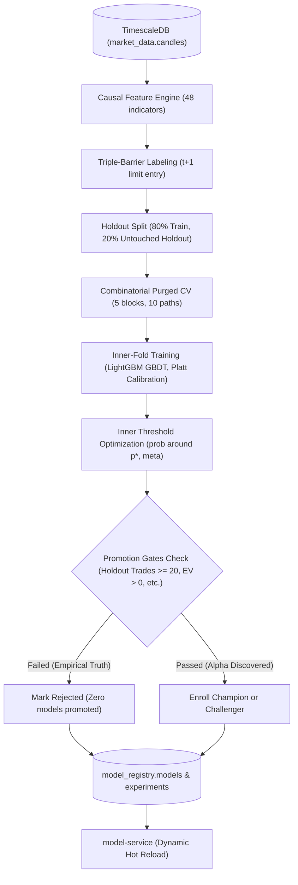

# Machine Learning & Quantitative Modeling Pipeline

> **Scope**: Crypto futures paper trading & research only.
> **Source of Truth**: [`services/training-service/`](file:///services/training-service/) and [`services/feature-service/`](file:///services/feature-service/).
> **Champion Policy**: Zero models promoted to champion or challenger. Live status: "No validated model".

---

## 1. Feature Groups & Causal Engineering

The feature engineering pipeline computes **48 causal indicators** from closed OHLCV bars. Features are calculated point-in-time with strictly closed historical data, guaranteeing zero lookahead bias.

### Feature Families:
1. **Trend & Moving Averages**: Exponential Moving Averages (`ema_9`, `ema_21`, `ema_50`), MACD line, signal, and histogram (`macd_12_26_9`).
2. **Momentum & Oscillators**: Relative Strength Index (`rsi_14`), Stochastic RSI, Average Directional Index (`adx_14`).
3. **Volatility & Price Envelope**: Average True Range (`atr_14`), Normalized ATR (`natr_14`), Bollinger Bands width (`bb_width_20_2.0`), Bollinger %B (`bb_pct_b`).
4. **Cross-Asset & Regime Features**: Rolling 48-bar correlation with Bitcoin returns (`btc_correlation_48`), Volatility Regime ratio (current ATR relative to rolling 96-bar median).
5. **Cyclical Temporal Features**: Sine and cosine cyclical encodings for hour-of-day ($24\text{h}$) and day-of-week ($7\text{d}$).

### Higher-Timeframe & Closed-Bar-Only Rule
- Features are strictly computed on closed bars (`is_closed = True`).
- Higher timeframe features (e.g., 4h indicators aligned with 1h execution) strictly reference the most recently completed 4h bar, preventing lookahead leakage from unclosed bars.

### Exclusion of Short-History Features
> [!IMPORTANT]
> **Data Integrity Policy**: Features requiring Binance derivatives metrics with limited public API history (Open Interest, Long/Short Ratio, Taker Buy/Sell Volume) are **strictly excluded from model training**.
> 
> Binance public REST endpoints provide only a few months of historical Open Interest and LSR data, compared to 3+ years of historical klines and funding history (2021–2026). Including short-history features would introduce forward survival bias or require massive NaN imputation over earlier market regimes. These features are documented as research extensions for when sufficient real-time historical data accumulates.

---

## 2. Triple-Barrier Labeling & Limit-Order Execution

Labels are generated using Marcos López de Prado's Triple-Barrier Method, enhanced with realistic limit-order fill mechanics:

### Barrier Geometry:
- **Upper Barrier (Take Profit)**: $\text{Entry} + (2.0 \times \text{ATR}_{14})$ for Longs; $\text{Entry} - (2.0 \times \text{ATR}_{14})$ for Shorts.
- **Lower Barrier (Stop Loss)**: $\text{Entry} - (1.0 \times \text{ATR}_{14})$ for Longs; $\text{Entry} + (1.0 \times \text{ATR}_{14})$ for Shorts.
- **Vertical Barrier (Time Limit)**: Maximum holding period of 24 bars (`max_holding_bars = 24`).

### Realistic Limit-Order Entry ($t+1$):
- Predictions made at candle $t$ close do not fill instantly at $C_t$.
- Limit orders are placed at $C_t$ and can only fill on subsequent bars $t+1 \dots t+2$ if the price trades through the limit:
  - Long Fill: $\text{Low}_{t+k} \le C_t$
  - Short Fill: $\text{High}_{t+k} \ge C_t$
- Orders unfulfilled after 2 bars expire without opening a trade.

### Strict Stop-Loss-First Disambiguation:
- If a bar's high-low range simultaneously breaches both Take Profit and Stop Loss barriers, **Stop Loss is strictly assumed to have hit first**.

---

## 3. Combinatorial Purged Cross-Validation (CPCV)

To prevent overfitting and information leakage across overlapping triple-barrier holding windows, validation employs Combinatorial Purged Cross-Validation:

- **Block Partitioning**: Training history is partitioned into $N = 5$ contiguous blocks.
- **Combinations**: $k = 2$ blocks are held out in each fold, producing:
  $$S = \binom{5}{2} = 10 \text{ combinatorial testing paths}$$
- **Purging**: Training samples whose triple-barrier event windows overlap with test set boundaries are purged from training folds.
- **Embargo**: A 24-bar embargo window (`embargo_bars = 24`) is appended after test blocks to eliminate auto-correlation leakage.
- **Sample Uniqueness Weighting**: Uniqueness weights ($W_i$) scale sample importance based on label concurrency:
  $$c_t = \sum_{j} \mathbf{1}_{t \in [t_{j, \text{start}}, t_{j, \text{end}}]}, \quad u_{i, t} = \frac{1}{c_t}, \quad W_i = \frac{1}{\ell_i} \sum_{t} u_{i, t}$$

---

## 4. Probability Calibration (Platt Scaling)

Raw gradient-boosted decision tree outputs do not reflect true posterior class probabilities.
- Model architecture: LightGBM GBDT wrapped in `CalibratedClassifierCV(method='sigmoid', cv=3)`.
- Calibration maps raw margins to the empirical triple-barrier base rate ($\approx 31.4\% - 32.2\%$ win rate across crypto perpetuals).
- Evaluated via Expected Calibration Error (ECE) and Maximum Calibration Error (MCE) across 10 decile bins:
  $$\text{ECE} = \sum_{b=1}^{B} \frac{|B_b|}{N} |\text{acc}(B_b) - \text{conf}(B_b)|$$

---

## 5. Inner-Fold Dynamic Threshold Optimization

Thresholds are **never tuned on the holdout set**. Probability and meta-model thresholds are selected strictly inside each path's inner training split:

### Dynamic Break-Even Probability Gate ($p^*$):
Derived from each bar's volatility and transaction costs:
$$p^*_i = \frac{\text{stop\%}_i + \text{friction}}{\text{target\%}_i + \text{stop\%}_i} = \frac{\text{ATR\%}_i + 0.0014}{3.0 \times \text{ATR\%}_i}$$
- For a typical 1.5% ATR stop and 14 bps friction: $p^* \approx 36.44\%$.
- Inner folds search an objective grid centered around $p^*$ ($[p^*, p^* + 0.04]$ for probability; $[0.25, 0.50]$ for meta-model).
- Thresholds maximizing net Sharpe subject to minimum trade count constraints are frozen and applied untouched to out-of-fold and holdout evaluation.

---

## 6. Strict Model Promotion Gates

To achieve Champion or Challenger promotion, a candidate model must pass all 6 empirical gates on the untouched holdout window:

| Promotion Gate | Required Metric Threshold | Source in Code | Purpose |
| :--- | :--- | :--- | :--- |
| **Minimum Trades** | Holdout executed trades $\ge 20$ | `evaluator.py::min_trades_holdout` | Prevents sample-size illusions & zero-trade artifacts |
| **Positive Net EV** | $\text{Net EV} > 0.00\%$ after 14 bps fee & funding | `evaluator.py::gate_ev_positive` | Ensures statistical profitability net of all costs |
| **Bootstrap CI Gate** | Lower bound of 95% bootstrap CI $> 0.00\%$ | `evaluator.py::gate_bootstrap_ci_passed` | Verifies edge is statistically distinguishable from zero |
| **CPCV Median Sharpe** | Median out-of-sample path Sharpe $> 0.00$ | `evaluator.py::gate_sharpe_positive` | Confirms robustness across temporal permutations |
| **Probability of Overfitting** | $\text{PBO} < 0.50$ (CSCV rank PBO) | `evaluator.py::gate_pbo_passed` | Marcos López de Prado's overfitting ceiling |
| **Calibration Quality** | Expected Calibration Error $\text{ECE} \le 0.12$ | `evaluator.py::gate_ece_passed` | Ensures probabilities reliably represent hit rates |

---

## 7. Model Life Cycle & Shadow Execution

```
Training Pipeline ──► Inner CPCV ──► Promotion Gates ──► model_registry.models
                                                               │
                ┌──────────────────────────────────────────────┴──────────────────────────────┐
                ▼                                                                             ▼
        Stage: 'champion'                                                             Stage: 'shadow'
        Live Signal Ingestion & Paper Sizing                                          Zero Capital Allocation
        Stream: prediction.ready                                                      Table: model_registry.shadow_predictions
```

- **Champion**: Live operational model driving paper trade execution.
- **Shadow (Challenger)**: Forward-tested on live incoming ticks without capital risk. Predictions are written to `model_registry.shadow_predictions` to monitor out-of-sample degradation.
- **Feature Drift Monitoring**: Population Stability Index (PSI) and Wasserstein distance are computed between training feature distributions and live inference features. If $\text{PSI} > 0.25$, an alert is triggered.
- **Hot-Reloading**: `model-service` polls `model_registry.models` and hot-reloads new champion artifacts dynamically without dropping WebSocket connections.

---

## 8. Deflated Sharpe Ratio (DSR) & True Trial Count

Under multiple hypothesis testing, selection bias inflates observed Sharpe ratios. We apply Marcos López de Prado and David Bailey's Deflated Sharpe Ratio:

$$\text{DSR} = \Phi\left(\frac{(\widehat{\text{SR}} - \text{SR}^*) \sqrt{T-1}}{\sqrt{1 - \widehat{\gamma}_3 \widehat{\text{SR}} + \frac{\widehat{\gamma}_4 - 1}{4}\widehat{\text{SR}}^2}}\right)$$
$$\text{SR}^* = \sqrt{2 \ln(N_{\text{trials}})} \left(1 - \frac{\gamma}{\sqrt{2 \ln(N_{\text{trials}})}}\right) + \frac{\text{Euler-Mascheroni}}{\sqrt{2 \ln(N_{\text{trials}})}}$$

- **Dynamic Trial Derivation**: $N_{\text{trials}}$ is not hardcoded. It is dynamically queried directly from the `model_registry.experiments` database table, which logs every parameter combination and threshold variant evaluated ($N_{\text{trials}} = 208+$).

---

## 9. Offline Machine Learning Loop Diagram (Mermaid)



