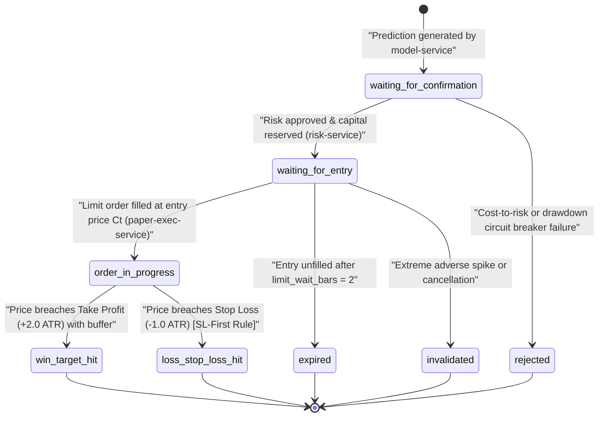

# Authoritative Signal Lifecycle & State Machine

> **Scope**: Crypto futures paper trading & research only.
> **Source of Truth**: [`services/signal-service/state_machine.py`](file:///services/signal-service/state_machine.py) and [`services/paper-exec-service/engine.py`](file:///services/paper-exec-service/engine.py).

---

## 1. Authoritative State Machine Diagram (Mermaid)



---

## 2. Complete State Transition Matrix & Ownership

Each transition is owned by a single microservice to prevent distributed race conditions or duplicate state transitions:

| From State | To State | Triggering Event | Owner Service | Concurrency Guard |
| :--- | :--- | :--- | :--- | :--- |
| `[*]` | `waiting_for_confirmation` | `prediction.ready` | `model-service` | Insert with initial prediction ID |
| `waiting_for_confirmation` | `waiting_for_entry` | `signal.approved` | `risk-service` -> `signal-service` | Postgres Advisory Lock (`888888`) |
| `waiting_for_confirmation` | `rejected` | `signal.rejected` | `risk-service` | Postgres Advisory Lock (`888888`) |
| `waiting_for_entry` | `order_in_progress` | Limit fill on live tick | `paper-exec-service` | Optimistic Lock (`v1 -> v2`) |
| `waiting_for_entry` | `expired` | 2-bar timeout reached | `signal-service` | Optimistic Lock (`v1 -> v2`) |
| `waiting_for_entry` | `invalidated` | Extreme adverse regime | `signal-service` | Optimistic Lock (`v1 -> v2`) |
| `order_in_progress` | `win_target_hit` | `trade.closed` (`target_hit`) | `paper-exec-service` (Owner) | Optimistic Lock (`v2 -> v3`) |
| `order_in_progress` | `loss_stop_loss_hit` | `trade.closed` (`stop_hit`) | `paper-exec-service` (Owner) | Optimistic Lock (`v2 -> v3`) |

---

## 3. Barrier Formulas & Execution Semantics

The barrier framework follows Marcos López de Prado's Triple-Barrier Method adapted for cryptocurrency perpetual futures.

### Shared Production Multipliers (`DEFAULT_BARRIER_CONFIG`):
Defined centrally in [`libs/common/risk_rules.py`](file:///libs/common/risk_rules.py) and shared across all services:
- **Take Profit Multiple (`pt_multiplier`)**: `2.0x ATR`
- **Stop Loss Multiple (`sl_multiplier`)**: `1.0x ATR`
- **Risk-to-Reward Ratio**: Strictly `1:2`
- **Max Holding Period (`max_holding_bars`)**: 24 bars (vertical time barrier)

### Exact Barrier Calculations:

#### For LONG Positions:
$$\text{Entry Price} = C_t$$
$$\text{Take Profit} = \text{Entry Price} + (2.0 \times \text{ATR}_{14})$$
$$\text{Stop Loss} = \text{Entry Price} - (1.0 \times \text{ATR}_{14})$$

#### For SHORT Positions:
$$\text{Entry Price} = C_t$$
$$\text{Take Profit} = \text{Entry Price} - (2.0 \times \text{ATR}_{14})$$
$$\text{Stop Loss} = \text{Entry Price} + (1.0 \times \text{ATR}_{14})$$

---

## 4. Same-Bar Ambiguity Resolution: Strict SL-First Rule

In historical backtesting and high-volatility live trading, price spikes can penetrate both the Take Profit barrier and the Stop Loss barrier within the same bar or tick window.

> [!CAUTION]
> **Strict SL-First Rule**: Whenever a single bar or high-low range touches or breaches both the Take Profit and Stop Loss barriers simultaneously, the system **strictly assumes Stop Loss was hit first**. 
>
> Assuming Take Profit when both barriers are touched introduces massive optimistic lookahead leakage. The SL-first rule guarantees zero survivorship or execution bias.

---

## 5. Price Semantics: Mark Price vs Last Price

Cryptocurrency perpetual markets feature two distinct price streams:
1. **Last Trade Price (`price.tick::price`)**: The latest match price on the order book.
2. **Mark Price (`price.tick::mark_price`)**: The fair index price adjusted for funding rate basis, calculated by Binance to prevent manipulation cascades.

### Usage in the Architecture:
- **Order Fills (`paper-exec-service`)**: Evaluated against **Last Price** to simulate resting limit order interaction with the matching engine.
- **TP / SL Barrier Monitoring & Liquidation Risk**: Evaluated strictly against **Mark Price** with a 5 bps (0.05%) trade-through buffer. This prevents phantom stop-outs caused by temporary illiquidity wicks on the last price.
- **Account Unrealized PnL**: Computed strictly against **Mark Price**.

---

## 6. Single-Owner Architecture (Phase 6.8 Reconciliation)

Prior to Phase 6.8, both `signal-service` and `paper-exec-service` evaluated live price ticks independently, creating potential race conditions where a signal could be closed before the paper trade was finalized.

Under the unified single-owner architecture:
1. `paper-exec-service` is the **SOLE OWNER** of live position lifecycle monitoring and TP/SL exits.
2. Upon barrier breach, `paper-exec-service` writes the finalized PnL, fees, and funding to `paper_execution.paper_trades`, and publishes `trade.closed`.
3. `signal-service` subscribes to `trade.closed` to transition the authoritative signal record in `signals_ledger.signals` via optimistic locking (`v2 -> v3`).
4. **Duplicate tick evaluation is completely eliminated**.

---

## 7. Optimistic Concurrency Control

Signal state updates enforce optimistic locking to prevent double execution across distributed instances:

```python
query = text("""
    UPDATE signals_ledger.signals
    SET status = :new_status,
        version = version + 1
    WHERE id = :signal_id AND version = :current_version
    RETURNING version;
""")
async with engine.begin() as conn:
    res = await conn.execute(query, {
        "new_status": new_status,
        "signal_id": signal_id,
        "current_version": current_version,
    })
    row = res.fetchone()
    if row:
        return True # Transition succeeded
    else:
        # Version conflict: state was mutated by a concurrent process
        return False
```
